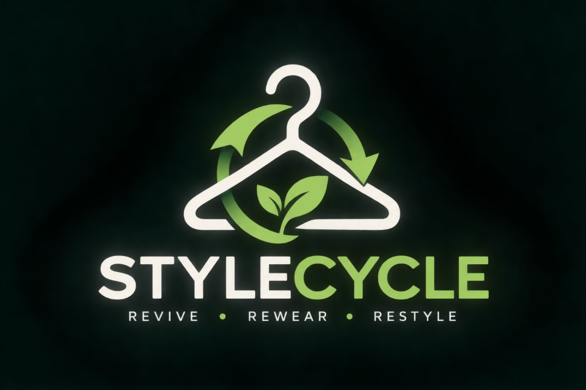

<div align="center">



# STYLECYCLE

### *Your Closet. Your Style. Your Cycle.*

**A Smart Fashion Buy, Sell & Exchange Marketplace with Personalised Wardrobe Styling, Intelligent Fit Matching & Circular Analytics.**

[](https://react.dev/)
[](https://vitejs.dev/)
[](https://tailwindcss.com/)
[](https://reactrouter.com/)
[]()

---

</div>

## 1. Project Overview

**STYLECYCLE** is a next-generation circular fashion e-commerce marketplace and wardrobe intelligence platform. It tackles fast-fashion waste, size uncertainty, wardrobe clutter, and high retail markups by uniting peer-to-peer circular commerce with deterministic fit algorithms and personalized styling intelligence.

The central business model is built around **Buy, Sell, and Exchange**:
- **Buy**: Curated pre-owned and new verified designer fashion at up to 70% below retail prices.
- **Sell**: Monetize unworn apparel through a streamlined listing studio with instant canvas image compression, transparent condition scoring, and automated discount calculations.
- **Exchange**: 1:1 wardrobe-to-wardrobe swaps with optional cash difference adjustments, eliminating unnecessary monetary expenditure.

---

## 2. Key Features

### 🛒 1. Circular Marketplace (Buy, Sell & Exchange)
- Multi-faceted catalog search and filtering across categories, brands, sizes, conditions, and price ranges.
- Peer-to-peer clothing exchange workflow with incoming/outgoing proposal dashboards and trade acceptance logic.
- Transparent 4-tier condition grading: *Brand New with Tags*, *Like New*, *Good Condition*, and *Fair Condition*.

### 📏 2. FitMatch Intelligence
- Eliminates size guesswork and costly return logistics.
- Collects body measurements (Height, Chest, Waist, Hips, Shoulder, Inseam) in inches or centimeters with customizable ease preferences (*Slim*, *Regular*, *Relaxed*, *Oversized*).
- Deterministic sizing comparison against brand-specific dimensional grading curves (Zara, Levi's, Massimo Dutti, H&M, Uniqlo, COS) with percentage confidence scores.

### 👗 3. Digital Wardrobe Studio
- Digitizes user closets by categorizing items by garment type, brand, size, color palette, season, and occasion.
- Tracks garment wear counts and favorites, computing circular utilization metrics and cost-per-wear estimates.
- Client-side Canvas downscaling (~800x1000px WebP) to prevent storage exhaustion and ensure fast loading.

### ✨ 4. AI Personal Stylist
- Contextual outfit generator matching tops, bottoms, outerwear, footwear, and accessories directly from the user's digitized wardrobe.
- Supports occasion-tailored generation (Office, Casual, College, Evening Party, Wedding, Travel, Formal) with style aesthetics and color harmonization rationales.

### 🛍️ 5. Smart Shopping (Wardrobe Gap Analysis)
- Identifies missing wardrobe staples and foundational gaps based on the user's digitized wardrobe.
- Suggests complementary pre-owned listings available in the marketplace rather than encouraging redundant impulse purchases.

### 📊 6. Executive Data Analytics Dashboard
- Administrator analytics suite powered by Recharts:
  - Gross Marketplace Value (GMV) trends and turnover projections.
  - Category distribution and circular inventory ratios.
  - Peer-to-peer exchange volume tracking.
  - Product Authenticity Moderation Queue and User Directory management.

---

## 3. Technology Stack

### Frontend Architecture
- **UI Framework:** [React.js](https://react.dev/) (v18.3.1)
- **Build Tool:** [Vite](https://vitejs.dev/) (v5.4.21)
- **Styling:** [Tailwind CSS](https://tailwindcss.com/) (v3.4.16), PostCSS, Autoprefixer
- **Typography:** Playfair Display (Luxury Editorial Serif) & Plus Jakarta Sans (Clean Modern Sans-Serif)
- **Icons:** [Lucide React](https://lucide.dev/) (v0.460.0)
- **Routing & Guards:** [React Router DOM](https://reactrouter.com/) (v6.30.6) with `ProtectedRoute` and `AdminRoute`
- **Charts:** [Recharts](https://recharts.org/) (v2.13.3)
- **HTTP Client:** [Axios](https://axios-http.com/) (v1.7.9) with `withCredentials: true`

### Backend & AI/ML Scaffolds (Phases 2 & 3)
- **API Framework:** Python 3.11+, [FastAPI](https://fastapi.tiangolo.com/), Pydantic v2
- **Database & ORM:** PostgreSQL, SQLAlchemy 2.0, Alembic migrations
- **Authentication:** Signed HttpOnly JWT cookies, Passlib (Argon2 / Bcrypt)
- **AI/ML:** OpenCV, Pillow, Scikit-learn, Pretrained ResNet/CLIP embeddings
- **Storage:** AWS S3 / Cloudinary cloud asset storage

---

## 4. Project Structure

```
STYLECYCLE/
├── frontend/                        # React Single Page Application
│   ├── public/                      # Static web assets & brand logo
│   │   ├── images/stylecycle-logo.png
│   │   └── favicon.png
│   ├── src/
│   │   ├── assets/                  # Brand assets & static media
│   │   ├── components/              # Reusable UI component library
│   │   │   ├── common/              # Navbar, Footer, ProductCard, ProtectedRoute, AdminRoute
│   │   │   ├── marketplace/         # ProductFilters, ProductSort
│   │   │   ├── exchange/            # ExchangeCard, ExchangeRequestModal
│   │   │   ├── fitmatch/            # MeasurementForm, SizeRecommendationCard
│   │   │   ├── wardrobe/            # WardrobeUploadModal, WardrobeStats, WardrobeItemCard
│   │   │   └── stylist/             # OutfitGeneratorForm, OutfitDisplayCard
│   │   ├── context/                 # Auth, Cart, Wishlist, Wardrobe, Listing Contexts
│   │   ├── data/                    # Curated catalog data, size charts, mock analytics
│   │   ├── layouts/                 # MainLayout, AdminLayout
│   │   ├── pages/                   # All 20 application page views
│   │   ├── services/                # Decoupled API service abstractions
│   │   └── utils/                   # Image security, currency formatters, conversions
│   ├── package.json
│   ├── tailwind.config.js
│   └── vite.config.js
│
├── backend/                         # FastAPI Python backend (Phase 2 scaffold)
│   ├── app/
│   │   ├── api/                     # REST API route handlers
│   │   ├── core/                    # Security, hashing, config
│   │   ├── models/                  # SQLAlchemy ORM models
│   │   ├── schemas/                 # Pydantic validation schemas
│   │   └── services/                # Backend business logic
│   └── requirements.txt
│
├── database/                        # Database schemas & migrations
│   ├── migrations/                  # Alembic migration versions
│   ├── schema/                      # DDL & relational ER models
│   └── seed/                        # Initial marketplace seed data
│
├── ai_ml/                           # AI/ML & computer vision pipeline scaffolds
│   ├── fitmatch/                    # Fit prediction & dimensional grading curves
│   ├── wardrobe/                    # Garment classification & segmentation
│   └── stylist/                     # Color harmonization & outfit pairing graphs
│
├── storage/                         # Local sandbox upload storage
├── deployment/                      # Docker & deployment manifests
├── scripts/                         # Maintenance & automation utilities
├── .gitignore
└── README.md
```

---

## 5. Security & Defensive Hardening

STYLECYCLE has undergone application-level security remediation:
- **Role-Based Access Control:** Reusable `AdminRoute` and `ProtectedRoute` components guard executive tools and user profile surfaces.
- **Client Role Hardening:** Server-authoritative role assignment patterns; registration forms cannot elevate privileges.
- **File Upload Safeguards:** Strict raster validation (`JPEG`, `PNG`, `WebP`), rejection of vector SVGs and executables, 5 MB caps, and HTML5 Canvas downscaling to prevent browser storage exhaustion.
- **Checkout Integrity:** In-flight double-submission locking, unique idempotency keys (`IDEMP-...`), non-positive price rejection, and explicit demonstration status markers.
- **Network Isolation:** Development server bound strictly to loopback (`localhost`).

---

## 6. Getting Started

### Prerequisites
- **Node.js** v18.0.0 or higher
- **NPM** v9.0.0 or higher

### Installation & Local Run

```bash
# 1. Clone the repository
git clone https://github.com/nandith-m-y/STYLECYCLE.git
cd STYLECYCLE/frontend

# 2. Install dependencies
npm install

# 3. Start the local development server
npm run dev
```

Open your browser at **`http://localhost:5173`** to interact with the platform.

### Production Build

```bash
cd frontend
npm run build
```

Compiled production assets will be generated in `frontend/dist/`.

---

## 7. Demo Accounts

For local UI evaluation, quick-access credentials are provided on the Login page:

| Role | Email | Password | Access |
|---|---|---|---|
| **Customer** | `tara.style@example.com` | `password123` | Marketplace, Sell Studio, Wardrobe, AI Stylist, Checkout |
| **Administrator** | `admin@stylecycle.demo` | `adminDemo123!` | All features + Secured Executive Admin Portal (`/admin`) |

---

## 8. License & Authors

- **Author:** Nandith M Y ([@nandith-m-y](https://github.com/nandith-m-y))
- **Repository:** [https://github.com/nandith-m-y/STYLECYCLE](https://github.com/nandith-m-y/STYLECYCLE)
- **Tagline:** *Your Closet. Your Style. Your Cycle.*
